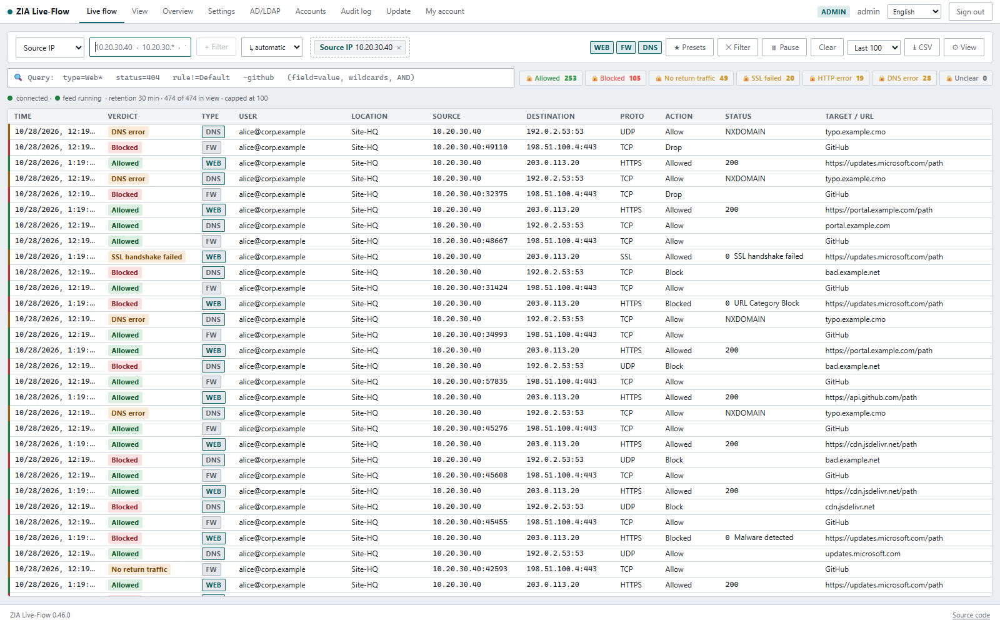
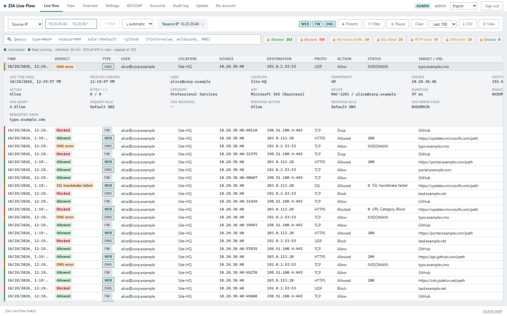
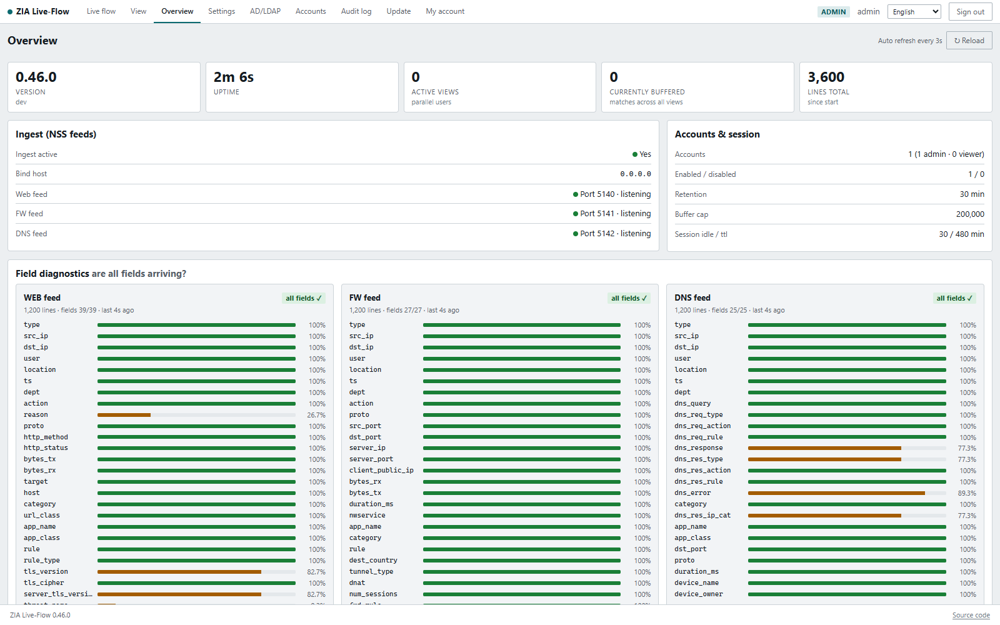
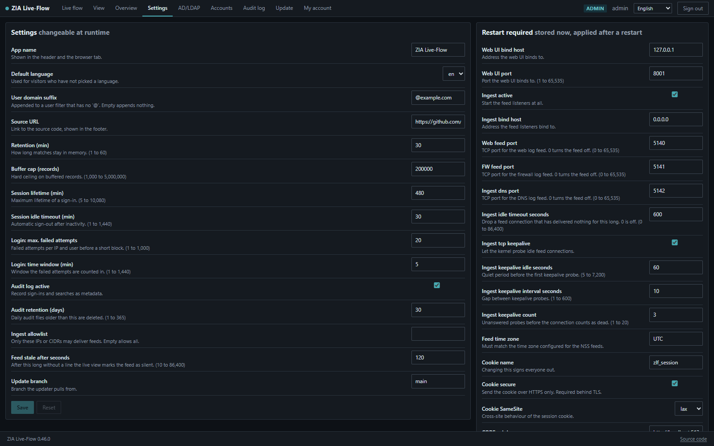

# ZIA Live-Flow

Live troubleshooting for **Zscaler ZIA web, firewall and DNS logs**. Three NSS feeds stream
into this tool over TCP. It filters for exactly one thing you are looking for (a source IP, a
destination IP, a user, or a location), discards everything else immediately, and shows the
matching traffic flow live, unified across all three feeds, and colour-coded by verdict.

It is a troubleshooting tool, not a SIEM. Nothing is written to disk: matches live in a RAM
ring buffer and expire after a configurable retention window.

- **Multi-user.** Every signed-in person gets their own filter, buffer and live stream, so
  several people can look at completely different traffic at the same time without
  interfering with each other.
- **One view for every feed.** Web, firewall and DNS records are normalised into a single
  schema and a single table, so you stop correlating three log formats by hand. Each feed can
  be switched off per view, so a noisy one does not bury what you are looking for.
- **Verdict colouring.** Green for allowed, amber for no return traffic, a failed TLS
  handshake or an HTTP error, red for blocked.
- **Access control.** Local accounts, plus optional directory login (AD/LDAP) and optional
  single sign-on (OpenID Connect). Granular permissions, including a view that masks all
  personal data for people who may analyse network problems but must not see who was
  involved.
- **Configurable at runtime.** Almost everything is editable in the admin backend rather
  than in files: branding, language, ports, retention, session behaviour, feed time zone,
  allowlists, audit retention.
- **Nine interface languages**, switchable per user. See [Languages](#languages).
- Stack: FastAPI (async TCP ingest and WebSocket) and React with TypeScript and Vite.




---

## Contents

- [Prerequisites](#prerequisites)
- [Quick start](#quick-start)
- [Running it](#running-it)
- [Ports](#ports)
- [Try it without a real NSS server](#try-it-without-a-real-nss-server)
- [Configuring the NSS feeds](#configuring-the-nss-feeds)
- [Using it](#using-it)
- [Screenshots](#screenshots)
- [Languages](#languages)
- [Permissions and the admin backend](#permissions-and-the-admin-backend)
- [Command line administration](#command-line-administration)
- [Configuration](#configuration)
- [Security and data protection](#security-and-data-protection)
- [Deployment](#deployment)
- [License](#license)

---

## Prerequisites

| Requirement | Why |
|---|---|
| **Python 3.11 or newer** | Runs the backend, the TCP ingest and the WebSocket. |
| **Node.js 20 or newer**, with npm | Builds the frontend once at install time. Not needed to run it afterwards. |
| **Git** | Only for cloning, and for the self-update feature on a server install. |
| **About 1 GB of free RAM** | For the default buffer ceiling of 200,000 records. Raise the ceiling and this grows. |
| **Reachable TCP ports** | 5140, 5141 and 5142 have to be reachable from your NSS servers. |

Runs on Windows, Linux and macOS. Nothing else needs installing: no database, no message
broker, no external service. Everything the app keeps is either in memory or in a handful
of JSON files under `backend/data/`.

The production deployment guide ([docs/DEPLOY.md](docs/DEPLOY.md)) covers a Linux install
as a systemd service behind nginx with TLS.

## Quick start

```bash
git clone https://github.com/NiclasInstinktB/ZIALiveFlow.git
cd ZIALiveFlow
python install.py
```

`install.py` creates the virtual environment, installs the backend dependencies, installs
and builds the frontend, and copies `.env.example` to `.env`. It is safe to run again later.

Then open `.env` and set two values:

```ini
# A long random signing key. Generate one with:
#   python -c "import secrets; print(secrets.token_urlsafe(48))"
JWT_SECRET=

# The first admin password. Leave it empty to have a random one
# written to the log once, on first start.
ADMIN_INITIAL_PASSWORD=
```

## Running it

**Linux and macOS**

```bash
./run.sh
```

**Windows**

```bat
run.cmd
```

Both are thin wrappers around `serve.py`, which you can also call directly:

```bash
.venv/bin/python serve.py           # Linux, macOS
.venv\Scripts\python serve.py       # Windows
```

Then open `http://127.0.0.1:8001` and sign in with the admin account.

`serve.py` exists for a reason worth knowing. The bind address and port are editable in the
admin backend, and a plain `uvicorn backend.main:app` would bind its socket from its own
command line before the app ever reads those stored values, so a port set in the UI would be
ignored forever. The launcher loads the stored settings first.

Overrides, highest precedence first: `--host` and `--port` on the command line, then
`APP_HOST` and `APP_PORT` in the environment, then what the admin backend stored, then the
defaults.

### Ports

| Port | Purpose |
|---|---|
| 8001/tcp | Web UI, API and WebSocket |
| 5140/tcp | NSS feed, **web logs** |
| 5141/tcp | NSS feed, **firewall logs** |
| 5142/tcp | NSS feed, **DNS logs** |

The feed ports have to be reachable from your NSS servers, so `INGEST_BIND_HOST` must
not be `127.0.0.1`. Open them in the firewall for the NSS server addresses only:

```bash
sudo ufw allow from 192.0.2.10 to any port 5140,5141,5142 proto tcp
sudo ufw allow 8001/tcp
```

As a second layer, `INGEST_ALLOWED_IPS` restricts which sources the application itself
accepts feed data from.

## Try it without a real NSS server

```bash
# With the server running, in a second terminal:
.venv/bin/python -m backend.tools.feed_sim --count 300 --rate 30
```

Then set a filter in the UI for source IP `10.20.30.40`, user `alice@corp.example`, or
location `Site-HQ`. The simulator emits lines in the exact feed format and checks at
startup that its field count still matches the schema in `backend/config.py`.

Run the tests with:

```bash
.venv/bin/python -m pytest backend/tests -q
```

---

## Configuring the NSS feeds

In the Zscaler console, under Administration, Nanolog Streaming Service, NSS Feeds, create
**three TCP feeds**: one of NSS type Web, one of type Firewall, one of type DNS. For each,
set **Feed Output Type** to Custom and the **field separator** to Tab, and point them at this
server on port 5140 (web), 5141 (firewall) and 5142 (DNS). The DNS feed is optional: set
`INGEST_DNS_PORT=0` to run without it.

Enter the following as the **Feed Output Format**, raw, on one line, where `\t` is a tab and
the line ends with `\n`. **Do not reorder the fields.** The order corresponds exactly to
`WEB_COLUMNS`, `FW_COLUMNS` and `DNS_COLUMNS` in [backend/config.py](backend/config.py), and
a mismatch shifts every column silently.

**Web, 39 fields:**
```
web\t%s{cip}\t%s{sip}\t%s{login}\t%s{location}\t%s{time}\t%s{dept}\t%s{action}\t%s{reason}\t%s{proto}\t%s{reqmethod}\t%s{respcode}\t%d{reqsize}\t%d{respsize}\t%s{url}\t%s{host}\t%s{urlcat}\t%s{urlclass}\t%s{appname}\t%s{appclass}\t%s{rulelabel}\t%s{ruletype}\t%s{clienttlsversion}\t%s{clientsslcipher}\t%s{srvtlsversion}\t%s{threatname}\t%s{malwarecat}\t%d{riskscore}\t%s{cintip}\t%s{ua}\t%s{devicehostname}\t%s{deviceowner}\t%s{contenttype}\t%s{ssldecrypted}\t%s{ssl_rulename}\t%s{externalspr}\t%s{urlfilterrulelabel}\t%s{rdr_rulename}\t%s{fwd_gw_name}\n
```

**Firewall, 27 fields:**
```
fw\t%s{csip}\t%s{cdip}\t%s{login}\t%s{location}\t%d{epochtime}\t%s{dept}\t%s{action}\t%s{ipproto}\t%d{csport}\t%d{cdport}\t%s{sdip}\t%d{sdport}\t%s{tsip}\t%ld{inbytes}\t%ld{outbytes}\t%d{durationms}\t%s{nwsvc}\t%s{nwapp}\t%s{ipcat}\t%s{rulelabel}\t%s{destcountry}\t%s{ttype}\t%s{dnat}\t%d{numsessions}\t%s{rdr_rulename}\t%s{flow_type}\n
```

**DNS, 25 fields:**
```
dns\t%s{cip}\t%s{sip}\t%s{login}\t%s{location}\t%d{epochtime}\t%s{dept}\t%s{req}\t%s{reqtype}\t%s{reqaction}\t%s{reqrulelabel}\t%s{res}\t%s{restype}\t%s{resaction}\t%s{resrulelabel}\t%s{error}\t%s{domcat}\t%s{respipcat}\t%s{dnsapp}\t%s{dnsappcat}\t%d{sport}\t%s{protocol}\t%d{durationms}\t%s{devicehostname}\t%s{deviceowner}\n
```

The **first five fields are identical in all three feeds** and form a positional prefilter:
`0` type (web, fw or dns), `1` source IP, `2` destination IP, `3` user, `4` location. They sit at
the front so the receiver can discard a line without parsing the rest of it.

Two things worth checking against the field picker in your console:

- If a token is named differently in your tenant, or is unavailable, **keep its position**
  and substitute a placeholder, then update the matching column tuple in
  `backend/config.py` and the simulator to match. Empty fields are harmless and render as a
  dash.
- **Admin, Overview, Field diagnostics** shows live whether the number of fields arriving
  matches the number expected, per feed.

Use **TCP, not UDP**. At the volumes these feeds reach, UDP drops records silently under
load and fragments long lines.

The **feed time zone** has to match `FEED_TIMEZONE`. The web feed sends `%s{time}` as local
time with no offset, so a wrong value shifts every web timestamp without any error
appearing. The firewall and DNS feeds send epoch milliseconds and are unaffected. More detail in
[docs/NSS-FEEDS.md](docs/NSS-FEEDS.md), and a full token reference in
[docs/zscaler-nss-fields.md](docs/zscaler-nss-fields.md).

---

## Using it

1. Sign in.
2. Build a filter in the **Live-Flow** tab (source IP, destination IP, user, location, with
   `*` and `?` wildcards) and add it. It takes effect immediately and applies only to your
   own session. Without an active filter, everything is discarded on purpose.

   Filters sit in **groups**. Within a group the group operator applies, between groups the
   operator shown between them, and you toggle both by clicking them. By default, several
   filters on the **same field** join with OR inside one group, and different fields join
   with AND. That makes both readings expressible, `(source A OR source B) AND target C` as
   well as `source A OR (source B AND target C)`, without typing parentheses. Drag a filter
   into another group to move it.
3. Matching flows stream in live, coloured by verdict. The **Time** column shows the
   timestamp from the log record itself, not when the server received it.
4. **Query search** runs over the flows already on screen: `field=value` with wildcards,
   free text, negation with `-`, and AND by juxtaposition, with autocompletion. The field
   list grows automatically as new fields appear.
5. **Query chips** are saved queries shown as buttons above the table. Clicking one filters
   the view (several active chips are OR, combined with the search box as AND) and the badge
   counts matches. Everyone can create personal chips. Administrators can publish global
   ones, which others can show, hide and reorder but not edit.
6. **View settings** (per account) control which columns are shown and in which order, which
   filter fields are offered, and which chips appear. **Presets** save filter combinations.
7. **Pause** freezes the view, **Clear** empties it.

### Wildcards behave differently in the two places

This trips people up, so it is worth stating plainly:

|  | without `*` | with `*` or `?` |
|---|---|---|
| **Prefilter** (filter bar) | **exact**, the whole field value | glob match |
| **Query** `field=value` | substring | glob match against the whole value |
| **Query** free text | substring across all fields | glob, word by word |

This matters most for locations, because Zscaler puts location and sub-location in one
field, for example `Site-HQ->other`. A prefilter for `Site-HQ` therefore matches
**nothing**, since the full value is different. Use `Site-HQ*` instead.

---

## Screenshots

The live flow is at the top of this page. Expanding a row shows everything the feed
carried for it, including the DNS specific fields on a DNS record:



The overview tells you whether the feeds are actually arriving and whether the number of
fields per line still matches the schema, which is the first thing to check when a feed
format changes:



Settings are split by whether they apply immediately or need a restart. Dark mode follows
the operating system:



---

## Languages

The interface ships in nine languages. Everyone picks their own from the switcher in the
header, and the choice is remembered in the browser.

| | | | |
|---|---|---|---|
| English (`en`) | Deutsch (`de`) | Français (`fr`) | Español (`es`) |
| Italiano (`it`) | Português (`pt`) | Nederlands (`nl`) | 日本語 (`ja`) |
| 简体中文 (`zh`) | | | |

Someone who has not chosen yet gets the language their browser asks for, and failing that
the instance default from **Admin, Settings, Default language**. English is the fallback
for any key a locale is missing, so a partial translation degrades to English for that one
string instead of showing a raw key.

Regions collapse onto the base code, so `de-AT` uses `de`, `pt-BR` uses `pt` and
`zh-Hans-CN` uses `zh`. Regional variants are not shipped separately.

### Adding or fixing a language

Locale files live in `frontend/src/i18n/locales/` as flat JSON. To add one, copy `en.json`,
translate the values, and register the file in `frontend/src/i18n/index.ts` (import it, add
it to `LANGUAGES`, add it to `resources`). Then add the code to the `default_language`
choices in `backend/settings_store.py` so it can be set as the instance default.

Three things to keep intact while translating:

- **Placeholders.** `{{count}}`, `{{domain}}` and friends are substituted at runtime and
  must survive verbatim.
- **Plural suffixes.** Keys ending in `_one` and `_other` are i18next plural forms. Some
  languages need more categories, French for instance also uses `_many`.
- **Example query strings.** They contain field aliases the parser matches literally, so
  `verdict=blocked` has to stay `verdict=blocked`.

Right-to-left languages are not supported yet: the stylesheet has no RTL handling, so
Arabic or Hebrew would render a broken layout rather than a translated one.

---

## Permissions and the admin backend

There are no roles. Permissions are granular and attach only to **groups**. Someone's
effective permissions are the union of all groups they belong to, whether as a local
account, a directory user, or through a directory group. Holding no permission at all means
no access. An administrator is simply someone who holds all of them.

| Permission | Opens |
|---|---|
| `logs` | Live-Flow and view settings, **plain text**, all fields and all filter fields |
| `logs_obf` | Live-Flow and view settings, **anonymised**, see below |
| `overview` | Overview: live status, listener status, field diagnostics |
| `settings` | Settings, and global query chips |
| `accounts` | Accounts and groups. The last active local account holding this is protected |
| `ldap` | Directory and single sign-on configuration |
| `audit` | The audit log |
| `update` | Triggering a self update |

**You can only grant a permission you hold yourself.** Because that rule can lock everyone
out (delete the last group holding `accounts` and nobody can repair it), `SUPERADMIN_USERS`
in the environment names break-glass accounts that always hold everything and cannot be
stripped through the UI.

### The anonymised view

For people who need to analyse network problems but must not see who was involved. An
account holding `logs_obf` but not `logs` gets:

- **User, department, device name and device owner replaced with `***`**, redacted on the
  server before the record leaves the process. Because it happens there, the masking also
  covers query search, chip counters, CSV export, the detail pane and the sample records in
  the chip editor. There is no path around it.
- **The user filter disabled**, on the server as well as in the UI. Otherwise you could
  filter for a guessed address and infer the person from whether matches appear. Search by
  source IP instead. Destination IP and location stay available.

`logs` beats `logs_obf`, so anyone holding both sees plain text. Revoking a permission
reaches a **running** stream within a few seconds, switching it to masked without a reload.

### Directory login and single sign-on

Both are optional, both are configured in the admin backend rather than in files, and both
run alongside local accounts rather than replacing them. Local accounts always keep working,
including during a directory outage.

Directory login authenticates with a simple bind as `user@LDAP_DOMAIN` and then reads group
membership. `LDAP_SERVER` accepts several servers for failover and supports the global
catalog (`gc://`, `gcs://`) for forest-wide group lookups. Single sign-on uses the
authorization code flow with PKCE. The identity comes from the ID token, while group
membership is loaded live from the directory, so both paths map to permissions the same way.
The bind password and the client secret are stored encrypted and never returned by the API.

A directory user is created as an account automatically on first sign-in, with no local
password. Disabling that account blocks access even with a valid directory login.

---

## Command line administration

`manage.py` works on the stored data and does not need the web UI running.

```bash
# Linux and macOS
./manage.sh status
./manage.sh status --json
./manage.sh users
./manage.sh useradd -u alice --perms logs,overview
./manage.sh passwd alice
./manage.sh disable alice
```

```bat
REM Windows
manage.cmd status
```

---

## Configuration

Settings resolve in this order, later winning over earlier: the defaults in
`backend/config.py`, then the env file, then real environment variables, then whatever the
admin backend has stored in `backend/data/runtime_settings.json`.

Almost everything is editable under **Admin, Settings**, and each setting is marked by tier.
Live settings apply at once. Restart settings (listening sockets, CORS, cookie attributes,
log format) are stored immediately but need a restart to take effect.

Only secrets are environment-only and never writable over HTTP: `JWT_SECRET`,
`APP_ENCRYPTION_KEY`, `ADMIN_INITIAL_PASSWORD`, the directory bind password and the OIDC
client secret.

`APP_ENV_FILE` points at a different env file, which is useful for running several instances
on one host. Setting it to empty ignores env files entirely and configures purely from real
environment variables. The test suite uses that to stay independent of your local `.env`.

See [.env.example](.env.example) for every value with an explanation.

---

## Security and data protection

- Log records containing personal data live **in memory only**, for at most
  `RETENTION_MINUTES`, and are never written to disk.
- The **anonymised view** redacts on the server, as described above. It is not UI cosmetics.
- The **audit log** records sign-ins and searches as metadata (who, from where, which
  filter), never the log payloads. It is stored as one JSONL file per day under
  `backend/data/audit/`, and files older than `AUDIT_RETENTION_DAYS` are deleted
  automatically.
- The WebSocket validates the same session cookie as the REST API.
- Behind TLS, set `SESSION_COOKIE_SECURE=true`. On plain http it has to be false, otherwise
  the browser discards the cookie and every sign-in appears to fail.
- The ingest ports accept feed data without authentication, because NSS does not offer any.
  Run them on an internal or otherwise restricted network segment, and use
  `INGEST_ALLOWED_IPS` in addition to a firewall rule.

---

## Deployment

[docs/DEPLOY.md](docs/DEPLOY.md) covers a Linux install as a systemd service behind nginx
with TLS, including the self-update path that the admin backend triggers.

## License

Copyright (C) 2026 Niclas Bammert.

Licensed under the **GNU Affero General Public License v3.0**. See [LICENSE](LICENSE).

In short: you may use, study, modify and share this, including inside a company, at no cost.
If you distribute a modified version, or run one as a network service that other people use,
you have to make your source available under the same license. That is the condition that
keeps it open.
